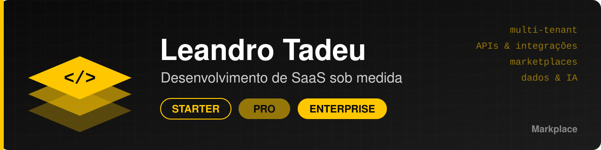

# Olá, eu sou o Leandro 👋
**Desenvolvimento de SaaS sob medida** — do MVP à operação em escala, com arquitetura multi-tenant, integrações com marketplaces e inteligência de dados.

🏢 OPS SaaS · 📍 São João da Boa Vista, SP · 🕒 GMT-3

---

## 🧱 Planos de serviço

| | **Starter** · MVP | **Pro** · Escala | **Enterprise** · Missão crítica |
|---|---|---|---|
| **Para quem** | Validar uma ideia rápido | SaaS com clientes pagantes | Operação com SLA e alto volume |
| **Front-end** | Web app responsivo | + painel do cliente e white-label | + design system próprio |
| **Back-end / API** | Auth, CRUD, painel admin | + multi-tenant, API REST documentada | + filas, workers, rate limiting |
| **Dados** | Banco relacional | + relatórios e exportações | + BI, data warehouse e IA aplicada |
| **Integrações** | 1 integração | ML, Shopee, Amazon, ERPs, gateways | Integrações customizadas e webhooks |
| **Cobrança** | — | Assinatura recorrente | Faturamento por uso / contratos |
| **Infra & segurança** | Deploy em nuvem + HTTPS | + CI/CD, backups, monitoramento | + hardening, logs de auditoria, LGPD |
| **Suporte** | Entrega + 30 dias | Mensal | SLA dedicado |

## 🛠️ Stack
`TypeScript` `Node.js` `React/Next.js` `Python` `PostgreSQL` `Supabase` `Cloudflare Workers` `Docker` `APIs REST`

## 📂 Projetos
- **SISVET** — plataforma web multi-clínica para gestão veterinária (migração de sistema legado)
- **Calculadora de Precificação ML/TikTok Shop** — ferramenta SaaS com licenciamento via Cloudflare Workers
- **CRMark** — assistente de IA para análise de contas de marketplace

## 📬 Contato
✉️ mktecommanalytics@gmail.com
